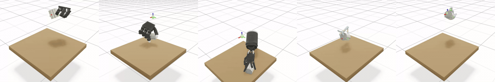
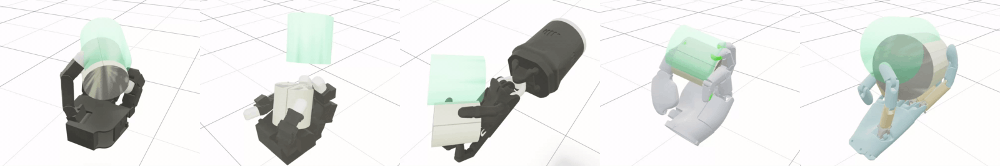

# mjlab dexhand

Dexterous manipulation tasks based on [mjlab](https://github.com/mujocolab/mjlab), providing grasping and in-hand rotation tasks for `Allegro`, `LEAP`, `Shadow`, `Sharpa`, and `Wuji`. It also includes the implementation of [ContactExplorer](https://arxiv.org/abs/2603.10971), which comprises:

- **Post-contact coverage reward**: rewards novel contacts between hand keypoints and object surface regions.
- **Pre-contact reaching reward**: guides hand keypoints toward under-explored object regions before contact.

## Tasks

<table>
  <tr>
    <th align="center"><code>Grasp-{Hand}</code></th>
  </tr>
  <tr>
    <td align="center"></td>
  </tr>
  <tr>
    <th align="center"><code>InHand-Rotation-{Hand}</code></th>
  </tr>
  <tr>
    <td align="center"></td>
  </tr>
</table>

`{Hand}` can be one of `Shadow`, `Allegro`, `LEAP`, `Sharpa`, or `Wuji`.

### Experimental Baoding and pen spinning

`Baoding-{Hand}` tracks two labeled balls around a horizontal orbit. Success requires
measured ball motion through a full revolution while tracking; advancing the target
alone does not count. `Pen-Spinning-{Hand}` rewards directed end-over-end rotation
of a horizontal pen while retaining it near the hand. Axial rolling does not count
as spinning. Both families are registered for all five hands.

**Status (2026-10-31): initial local pilots; successful expert policies are not yet
verified.** These are new independently implemented tasks, inspired by
[MyoChallenge Baoding](https://github.com/amathislab/myochallenge),
[PenSpin](https://github.com/HaozhiQi/penspin), and
[dexterous-gym pen spinning](https://github.com/henrycharlesworth/dexterous-gym/blob/master/dexterous_gym/envs/pen_spin.py).
Their reset geometry and learning recipes still need empirical validation across hands.

Run from the repo root on an already allocated GPU. The following trainer stays on
that GPU and never submits jobs. Use a fresh output directory for each run:

```bash
.venv/bin/python scripts/check_dexterity_envs.py --task Baoding-Allegro
.venv/bin/python scripts/train_dexterity_expert.py \
  --task Baoding-Allegro --output-dir outputs/dexterity/baoding_allegro_pilot \
  --num-envs 1024 --iterations 100 --seed 0 --save-interval 50

.venv/bin/python scripts/eval_dexterity_expert.py \
  --task Baoding-Allegro \
  --checkpoint outputs/dexterity/baoding_allegro_pilot/model_99.pt \
  --output-dir outputs/dexterity/baoding_allegro_eval --num-envs 100 --seed 1234 --video
```

Replace `Baoding-Allegro` with `Pen-Spinning-Allegro` and use separate output paths
for a pen-spinning pilot. Training saves TensorBoard logs, configurations and run
metadata, and retains the newest three checkpoints (`--keep-last`). Resume with
`--resume <checkpoint>` and a fresh output directory; `--iterations` then specifies
additional training iterations. Newly saved metadata checks task compatibility
before resuming or evaluating; legacy checkpoints without a signature emit a warning.

For longer training on the current GPU with automatic evaluation and video after
each cumulative stage:

```bash
.venv/bin/python scripts/run_dexterity_local.py --task Baoding-Allegro \
  --output-dir outputs/dexterity/baoding_staged --stages 1000 3000 10000
```

This submits no scheduler jobs. Its `workflow.json` records progress, checkpoint
paths, evaluation summaries and videos. See [E25](docs/experiment_log_book.md#e25)
for the initial results and viewable pilot videos; neither 100-iteration pilot
completes the task yet.

Evaluation scores each environment's first fresh-reset episode and writes JSON with
per-episode metrics, success, failures, timeouts and censored rollouts. The MP4 shows
environment 0 from that same evaluation, ending at its first episode boundary; it
does not select a successful rollout. Omitting `--checkpoint` produces an explicitly
labeled zero-action diagnostic. Do not interpret a pilot or diagnostic video as a
trained expert. Omitting `--task` from the smoke checker checks all ten new tasks.

For Slurm expert training on Vista, from a **login node** in this checkout:

```bash
# Scheduler projections, then a review of every planned task (no submission):
PROBE_ONLY=1 bash slurm_jobs/submit_dexterity_fast.sh
DRY_RUN=1 bash slurm_jobs/submit_dexterity_fast.sh
# Submit the gh training array:
bash slurm_jobs/submit_dexterity_fast.sh
```

The default trains the eight non-Allegro combinations in **gh only**: eight
independent one-node jobs, one policy/GPU, an 8-hour limit, and evaluation at
1k/3k/10k cumulative iterations. Existing Allegro runs are excluded. There is no
bootstrap partition or dependency. Override `TASKS`, `NODES`, `PACK`, `STAGES`,
and `TIME_LIMIT` when measurements and scheduler projections favor another shape.
The launcher rejects non-gh partition overrides. Jobs use an immutable source
archive; outputs live under `$SCRATCH/cross_embodied_diffusion/outputs/dexterity/`.
Each stage automatically evaluates and records video. `DEXTERITY_CACHE_ROOT`
keeps a task-private Warp cache on node-local storage across its stages.

Live status (also works with a scratch run root):

```bash
.venv/bin/python scripts/dexterity_status.py --roots outputs/dexterity
```

Training logs stream immediately; `progress.json` records wall-clock iteration
timing. Training success and held-out success are displayed separately.

The generic `collect-demos`, `eval-policy`, and diffusion task schemas have **not yet
been extended to these task commands**. First establish and evaluate RL experts with
the scripts above before collecting cross-embodiment demonstrations.

## Installation

```bash
git clone --recursive https://github.com/ruoyiqiao/mjlab_hand.git
cd mjlab_hand

# Install dependencies (Python ≥3.13 required)
uv sync
```

## Quick Start

Train grasping or in-hand rotation using Allegro Hand:

```bash
uv run train Grasp-Allegro --env.scene.num-envs 2048 --agent.max-iterations 10000
uv run train InHand-Rotation-Allegro --env.scene.num-envs 2048 --agent.max-iterations 10000
```

Useful flags: `--agent.seed`, `--env.scene.num-envs`, `--agent.max-iterations`, and `--env.rewards.contact_explorer_reward.weight 0.0` to disable ContactExplorer rewards.

## Custom Objects

Override the default object and scale:

```bash
# Train Allegro Hand to grasp a hammer
uv run train-object Grasp-Allegro --object hammer --env.scene.num-envs 2048

# Train Allegro Hand for in-hand rotation with a scaled cylinder
uv run train-object InHand-Rotation-Allegro --object cylinder_medium --scale 0.8,0.8,0.8
```

Objects are loaded from ContactDB. Examples: `cube`, `cylinder_medium`, `ps_controller`, `mug`, `flashlight`, `pan`.

> [!NOTE]
> Not every object in this repository has been tested. Some objects may need additional tuning on mdp components and training hyperparameters, to learn successfully.

## Evaluation & Playback

### Interactive Visualization

```bash
uv run play-object Grasp-Shadow --checkpoint-file /path/to/model.pt
```

### Batch Evaluation

```bash
uv run eval-policy --task Grasp-Allegro --checkpoint /path/to/model.pt --output eval_metrics.json
```

Prints success rate (grasp) or average successes before drop (rotation), and writes JSON when `--output` is provided.

**WandB integration:**

```bash
uv run eval-policy --task InHand-Rotation-Allegro --wandb-run-path entity/project/run_id
```

## Project docs (diffusion / BC work)

The cross-embodiment diffusion work is documented in [`docs/`](docs/README.md): the
[agent log book](docs/agent_log_book.md) covers implementation and reproduction, the
[experiment log book](docs/experiment_log_book.md) covers results and plots, and
[RUNS.md](docs/RUNS.md) lists every Slurm job and how to recreate it. Agent instructions are in [`AGENTS.md`](AGENTS.md).

## Data layout (diffusion / BC work)

All code and Slurm jobs refer to data by **repo-relative paths** and must be
run from the repo root. The bulk data lives wherever each machine has space;
the repo paths are symlinks to it, created once per machine (`data/`, `logs/`
and `outputs/` are gitignored, so the links are local, never committed):

| Repo path | Contents |
|---|---|
| `data/mjlab_hand_demos/` | Main diffusion training demos: `*_expert_1M.zarr`, `subsets_10k/`, `subsets_50k/`, `padded/` (~25 GB) |
| `logs/rsl_rl/` | RL experts; each dataset's zarr `checkpoint` attribute is a path under here |
| `outputs/` | Diffusion checkpoints, eval metrics, plots |
| `data/hf_staging/` | Only needed to *push* to the Hugging Face mirror |

The demos and the 10 RL experts that collected them are mirrored in the
private Hugging Face dataset repo `maxrudolph/mjlab-hand-demos` (ask for
access). Setting up a new machine:

```bash
git clone <this repo> && cd mjlab_hand
uv sync   # add --default-index https://pypi.org/simple if the Aliyun mirror fails TLS
uv pip install --index-url https://pypi.org/simple huggingface_hub
hf auth login

# Point the repo at local bulk storage (skip to keep data inside the repo dir).
mkdir -p /big/disk/mjlab_hand_demos data
ln -s /big/disk/mjlab_hand_demos data/mjlab_hand_demos

# Everything, or a subset via --include globs over repo paths:
uv run python scripts/hf_sync.py pull
uv run python scripts/hf_sync.py pull --include 'demos/subsets_50k/*' 'logs/*'
```

`pull` untars each dataset into `data/mjlab_hand_demos/` and restores the RL
experts under `logs/rsl_rl/`; it skips anything already present. After
collecting or building new datasets, `hf_sync.py stage` then `push` updates the
mirror. `stage` only tars zarrs without an archive yet (`--force` to re-tar a
changed one); `push` is resumable and uploads any file whose Hub copy is missing
or a different size.


## Acknowledgements

* This project builds on robot MJCF/XML assets from [MuJoCo Menagerie](https://github.com/google-deepmind/mujoco_menagerie), [sharpa-robotics](https://github.com/sharpa-robotics/sharpa-urdf-usd-xml), and [wuji-technology](https://github.com/wuji-technology/wuji-description).
* Object meshes are sourced from [ContactDB](https://contactdb.cc.gatech.edu/).

## Citation

If you find this project useful, please consider citing it:

```bibtex
@article{liu2026contactexplorer,
  title={Contact Coverage-Guided Exploration for General-Purpose Dexterous Manipulation},
  author={Liu, Zixuan and Qiao, Ruoyi and Tie, Chenrui and Liu, Xuanwei and Lou, Yunfan and Gao, Chongkai and Xu, Zhixuan and Shao, Lin},
  journal={arXiv preprint arXiv:2603.10971},
  year={2026}
}

@article{zakka2026mjlab,
  title={mjlab: A Lightweight Framework for GPU-Accelerated Robot Learning},
  author={Zakka, Kevin and Liao, Qiayuan and Yi, Brent and Lay, Louis Le and Sreenath, Koushil and Abbeel, Pieter},
  journal={arXiv preprint arXiv:2601.22074},
  year={2026}
}
```
